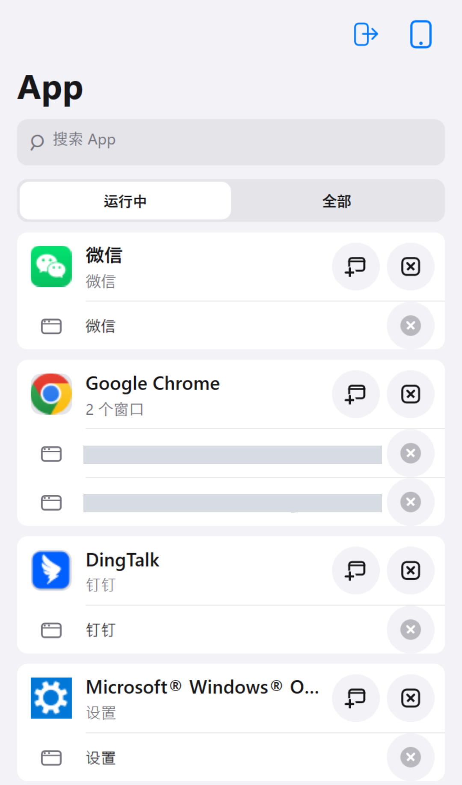
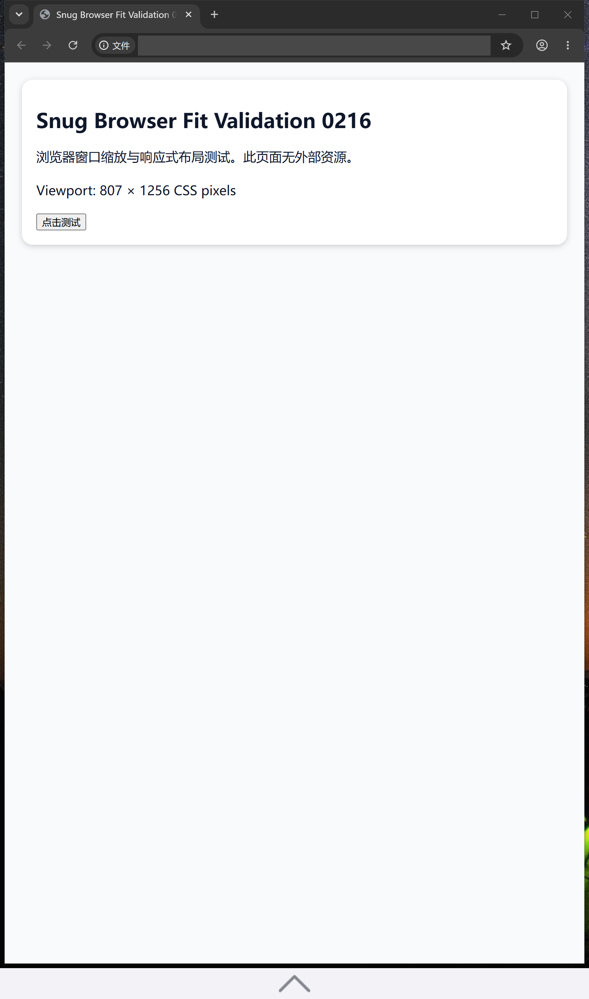
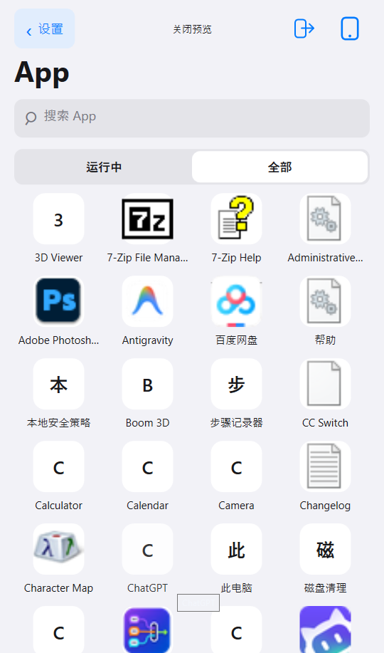
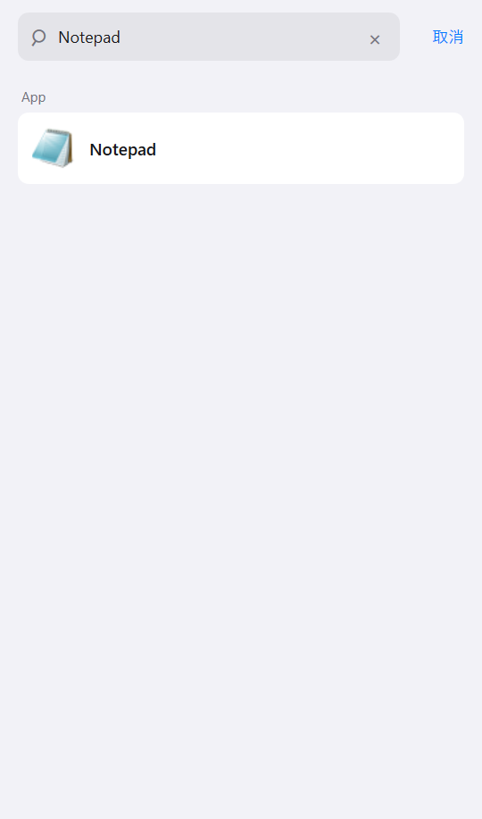
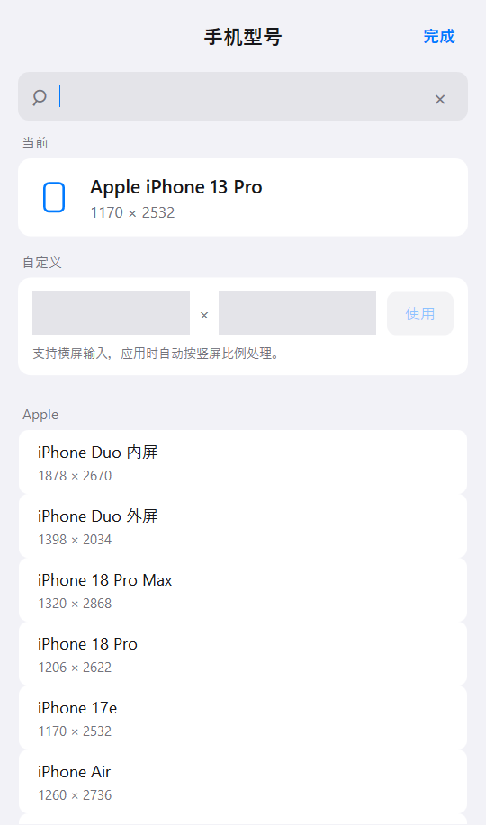
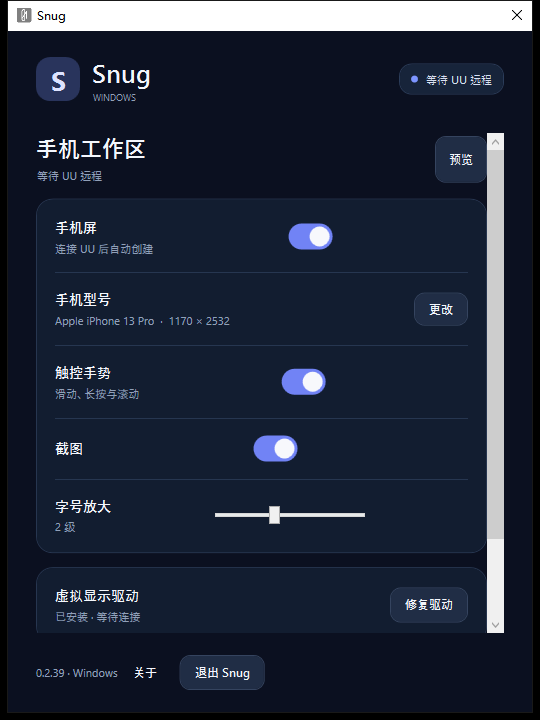
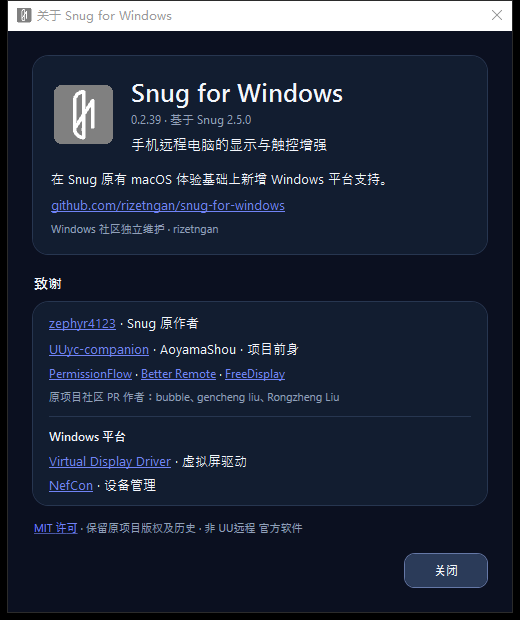

<div align="center">


# Snug for Windows

**让 Windows 电脑在手机上拥有原生级的操作体验**

为 UU 远程打造 · 独立竖屏 · 原生触控 · App 资源库

  [](LICENSE)

简体中文 · [English](README.en.md)

[下载](#下载安装) · [原生体验](#原生体验) · [App 资源库](#app-资源库) · [使用](#使用方法) · [开发](#开发)

</div>

<p align="center">


<br><sub>App 资源库 · Chrome 窗口铺屏</sub>
<br><sub>Windows 实际虚拟屏测试截图，私人标题及本地路径已隐藏。</sub>
</p>

Snug for Windows 是 [Snug](https://github.com/zephyr4123/snug) 的独立社区 Windows 移植项目，由 [rizetngan](https://github.com/rizetngan) 维护。基于 Snug 2.5.0，使用 C# / .NET 10 / WPF。macOS 用户请前往上游原项目。

## 下载安装

**0.2.39 社区预览版** · Windows x64（Windows 10 22H2 已实测）

**[下载安装包（Windows x64）](https://github.com/rizetngan/snug-for-windows/releases/download/v0.2.39/Snug-Setup-0.2.39-x64.exe)** · [发布说明](https://github.com/rizetngan/snug-for-windows/releases/tag/v0.2.39) · [SHA-256 校验](https://github.com/rizetngan/snug-for-windows/releases/download/v0.2.39/SHA256SUMS.txt) · [从源码构建](Platforms/Windows/README.md#构建与打包)

安装包：Snug-Setup-0.2.39-x64.exe。本次社区预览版修复 ETW 监视器会话泄漏，已通过实机验收。内置 .NET 运行时及签名虚拟显示驱动；安装器本身未签名，需管理员授权。升级后若无法识别已运行的 UU 服务，请先断开 UU，再重启其 Windows 服务或重启电脑一次。

## 原生体验

普通远程控制将整个 Windows 桌面缩放到手机屏幕上，小字和控件不易操作。Snug 为 UU 远程创建独立的竖屏，将正在使用的 Windows 窗口适配到手机尺寸；不用在手机上反复缩放整块桌面。

- **窗口铺满**：选择应用窗口后，按手机屏幕尺寸调整窗口；切换时恢复原来的受管理窗口。
- **字号与布局**：兼容的应用可调整字号；支持应用的最小宽度适配。
- **截图与裁剪**：在设置中开启截图后，可以将窗口画面复制到 Windows 剪贴板，再按需裁剪。

### 手机触控

| 操作 | Snug 手机屏 |
| :--- | :--- |
| 单指滑动 | 滚动页面与列表 |
| 水平滑动 | 对支持横向滚动的区域进行横向操作 |
| 长按 | 支持长按交互 |
| 底部返回条 | 返回 App 资源库 |

实际手势表现与 UU 触控模式及应用兼容性有关。

## App 资源库

无需回到电脑桌面，即可查看运行中的应用、搜索窗口、启动已安装的应用或切换至其他窗口。

<p align="center">



<br><sub>运行中 · 全部 · 搜索 Notepad（资源库实拍与 0.2.38 本地预览）</sub>
</p>

| 操作 | 方式 |
| :--- | :--- |
| 打开窗口 | 轻点对应的窗口条目 |
| 打开应用 | 在「全部」中选择应用 |
| 搜索 | 按应用名或窗口标题查找 |
| 新建与关闭 | 使用应用卡片上的按钮 |
| 返回资源库 | 轻点底部返回条 |

## 手机型号适配

Snug 根据手机型号调整虚拟显示比例，机型库也可与上游同步。首次使用时，在手机屏右上角或 Windows 设置中选择机型；未列出的设备可以使用自定义尺寸。

<p align="center">

<br><sub>机型选择：搜索型号并查看屏幕分辨率</sub>
</p>

## Windows 设置

在 Windows 上完成首次设置、选择手机型号、开启触控和截图。关于页面提供当前版本、独立仓库与原项目致谢。

<p align="center">


<br><sub>设置 · 关于（0.2.38 实际程序界面）</sub>
</p>

## 使用方法

1. 在电脑与手机安装 [UU 远程](https://uuyc.163.com/)，在电脑安装并运行 Snug。
2. 在设置中选择手机型号并开启手机屏。
3. 手机通过 UU 连接电脑，在屏幕列表选择 Snug Phone，使用屏幕触控模式。
4. 在 App 资源库打开窗口，轻点底部返回条切回资源库。
5. 退出手机屏后，可从主屏右下角「进入手机屏」重新创建，再通过 UU 切换显示器。结束远程后，Snug 恢复受管理窗口并释放虚拟屏。

<p align="center"><br><sub>Windows 特色：同一有效 UU 会话内重新进入手机屏</sub></p>

[详细安装与使用文档](Platforms/Windows/README.md) · [截图来源](Assets/WindowsMedia/README.md)

## 验证与限制

2026-11-18：276 项核心测试、Release 构建及 iPhone 13 Pro + UU 远程实机验收通过：后台监视器恢复、手机屏稳定、Chrome 铺屏、退出重进、断开后窗口还原及虚拟屏释放。

控制端设备类型与实际推流显示器身份仍未知；部分截图、字号兼容、多屏恢复及完整手势矩阵仍待扩大验证。

[验收记录](Platforms/Windows/ACCEPTANCE_20261118.md) · [更新记录](Platforms/Windows/CHANGELOG.md) · [已知限制](Platforms/Windows/README.md#已验证与限制)

## 开发

Windows 当前维护入口为默认分支 `main`，平台代码位于 [Platforms/Windows](Platforms/Windows/)。

```powershell
git clone https://github.com/rizetngan/snug-for-windows.git
cd snug-for-windows/Platforms/Windows
.\build-snug.cmd
.\run-snug.cmd
```

[构建、测试与打包](Platforms/Windows/README.md) · [移植进度](Platforms/Windows/PORTING_STATUS.md)

## 致谢与许可

感谢 [Snug / zephyr4123](https://github.com/zephyr4123/snug)、[UUyc-companion / AoyamaShou](https://github.com/aoyamashou/UUyc-companion)、原项目社区贡献者、[Virtual Display Driver](https://github.com/VirtualDrivers/Virtual-Display-Driver) 与 [NefCon](https://github.com/nefarius/nefcon)。

保留原项目历史、macOS 源码与版权声明。Windows 版本独立开发、发布和维护，不属于原项目官方 Windows 版本或 UU 远程官方软件。

[MIT License](LICENSE) · [第三方许可](Platforms/Windows/installer/THIRD_PARTY_NOTICES.md)
